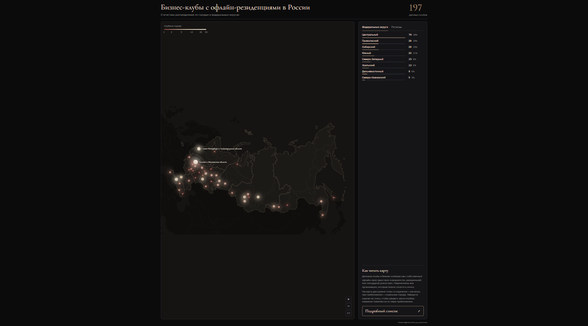

# Бизнес-клубы с офлайн-резиденциями в России

Интерактивная карта деловых клубов и бизнес-сообществ России, у которых есть офлайн-пространство: коворкинг, резиденция или иная площадка для встреч участников вживую.

**Посмотреть карту:** https://zykovkristian.github.io/business-clubs-map/

## Как пользоваться картой

- **Точки** — два уровня: в отдалении показаны регионы (46 точек), при приближении они раскрываются в отдельные города (66 точек) по фактическим координатам. Размер и цвет точки зависят от числа клубов по логарифмической шкале, поэтому Москва не заслоняет остальные города.
- **Наведите курсор на точку** — всплывёт подсказка: для региона — название и общее число клубов, для города — город, регион, округ и число клубов.
- **Масштаб** — колесо мыши, кнопки **+** / **−** или щипок на телефоне; перетаскивание двигает карту, кнопка **1:1** возвращает исходный вид. Названия появляются по мере приближения, максимальный зум разводит плотный московский кластер.
- **Вкладки справа** — переключение между рейтингом по федеральным округам и по регионам.
- **Наведите курсор на строку в рейтинге** — соответствующий округ или регион подсветится на карте, остальные приглушатся. В режиме городов регион подсвечивает все свои города.
- **Кнопка «Подробный список»** — переход в Telegram-канал автора за полным списком клубов.

## Что на карте

- 197 клубов по 8 федеральным округам.
- 197 клубов по 46 регионам.
- 197 клубов по 66 городам.
- Онлайн-сообщества и проекты без физической площадки не входят.

### Примечания к данным

- Ленинградская область учтена вместе с Санкт-Петербургом, Московская область — вместе с Москвой.
- Бурятия и Забайкальский край отнесены к Дальневосточному округу.
- Деревни и посёлки Московской области (Озёрки, Вешки, Юрлово, Хряслово, Дудкино, Октябрьский) отмечены как отдельные города; Троицк входит в Москву, Сириус — в Краснодарский край.
- Контуры стран — по открытой картографической основе: Крым в ней показан в составе Украины, Севастополь отмечен точкой.

## Как открыть карту у себя

1. Скачайте репозиторий (кнопка **Code → Download ZIP**) или клонируйте его.
2. Распакуйте и дважды кликните по `index.html` — карта откроется в браузере.
3. Интернет нужен только при первом открытии для загрузки шрифтов; без сети страница откроется с запасными шрифтами.

## Для тех, кто хочет изменить карту

Всё лежит в одном файле `index.html`: данные в объекте `const D` (округа, регионы, города и два набора точек), координаты точек и контуры стран — в inline-SVG. Точки и подписи строятся из данных при загрузке страницы.

- **Не редактируйте файл по частям.** Данные, точки и контуры связаны: изменение числа клубов требует пересчёта радиусов точек, цветов и шкалы. Правка одного куска без остальных ломает карту.
- **Координаты точек** — атрибуты `x`/`y` в `D.regionMarkers` и `D.cityMarkers` в системе viewBox 1000 × 667; новые города проецируются той же конической проекцией, что и контуры.
- **Не удаляйте ссылку на Google Fonts без замены шрифтов** (Cormorant Garamond, Golos Text) — иначе заголовки и текст потеряют задуманный вид.
- Внешних зависимостей и сборки нет: достаточно браузера.

## Источник и лицензия

Данные собраны с карты деловых клубов (`cyties.md` — исходная выгрузка по округам, регионам и городам). Полный список и обновления — в Telegram-канале [@communities_by_zykovkristian](https://t.me/communities_by_zykovkristian). Код распространяется по лицензии MIT (см. `LICENSE`). При публичном использовании данных указывайте источник.